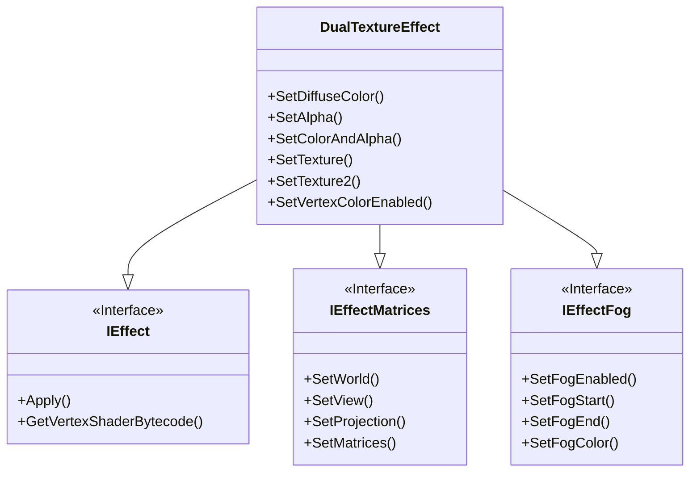

|[DirectXTK](DirectXTK.md)|[Effects](Effects.md)|
|---|---|

This is a native Direct3D 11 implementation of the built-in DualTextureEffect from XNA Game Studio 4 (``Microsoft.Xna.Framework.Graphics.DualTextureEffect``) which supports two layer multi-texturing (for [light maps](https://wikipedia.org/wiki/Lightmap) or detail textures), vertex color, and fogging.




```cpp
class DirectX::DualTextureEffect :
    public DirectX::IEffect,
    public DirectX::IEffectMatrices,
    public DirectX::IEffectFog
```

# Header
```cpp
#include <Effects.h>
```

# Initialization
Construction requires a Direct3D 11 device.

```cpp
std::unique_ptr<DualTextureEffect> effect;
effect = std::make_unique<DualTextureEffect>(device);
```

For exception safety, it is recommended you make use of the C++ [RAII](https://wikipedia.org/wiki/Resource_Acquisition_Is_Initialization) pattern and use a ``std::unique_ptr`` or ``std::shared_ptr``

# Interfaces

DualTextureEffect supports [IEffect](IEffect.md), [IEffectMatrices](IEffectMatrices.md), and [IEffectFog](IEffectFog.md)

Does not support lighting as it is assumed to be 'baked' into one of the two textures.

# Input layout
This effect requires ``SV_Position``, ``TEXCOORD0``, and  ``TEXCOORD1``. It requires ``COLOR`` if per-vertex colors are enabled.

# Properties

* **SetDiffuseColor**: Sets the diffuse color of the effect. Defaults to white (1,1,1). Alpha channel (.w component) is ignored.

* **SetAlpha**: Sets the alpha (transparency) of the effect. Defaults to 1 (fully opaque). This value is also used for binning opaque vs. transparent geometry.

* **SetColorAndAlpha**: Sets the diffuse color of the effect and the alpha (transparency).

* **SetVertexColorEnabled**: Enables per-vertex color. Defaults to false. Modifying this setting requires recreating associated input layouts, and enabling it requires ``COLOR``.

* **SetTexture**: Associates a texture shader resource view with the effect. Can be set to nullptr to remove a reference. This uses the sampler in slot 0. Can optionally include an alpha channel as well.

* **SetTexture2**: Associates a texture shader resource view with the effect. Can be set to nullptr to remove a reference. This uses the sampler in slot 1.

# Exceptions

The ctor can throw ``std::bad_alloc``.

The property methods of this implementation do not throw C++ exceptions.

# Remarks

This effect requires a texture sampler in both slots 0 and 1. [GeometricPrimitive](GeometricPrimitive.md) and [SpriteBatch](SpriteBatch.md) only set a texture sampler in slot 0 by default, [Model](Model.md) sets a sampler in slots 0 and 1.

[GeometricPrimitive](GeometricPrimitive.md), [Model](Model.md) loaded from ``VBO`` or ``CMO``, and [SpriteBatch](SpriteBatch.md) only define a single set of texture coordinates in their vertex buffers so they can't be used with DualTextureEffect.

<table border=0>
 <tr>
  <td>Diffuse map</td>
  <td>Light map</td>
 </tr>
 <tr>
  <td></td>
  <td></td>
 <tr>
</table>

# Further reading

[DualTextureEffect]( https://www.shawnhargreaves.com/blog/dualtextureeffect.html)  
