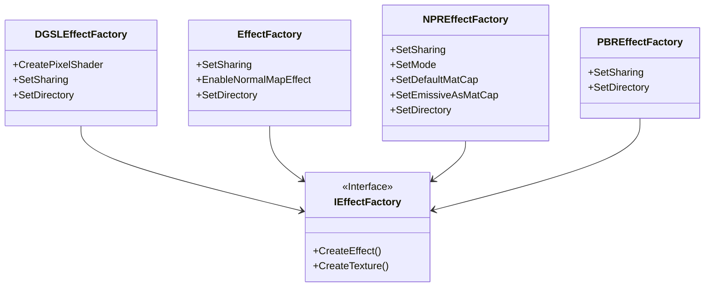

|[[DirectXTK]]|[[Effects]]|
|---|---|

This is a helper object primarily used by the [[Model]] loader implementations to provide sharing of material instances of [[Effects]] and textures. This can be used standalone as well, and allows access to any existing 'materials' definitions already created.

It uses a simple case-sensitive string-based (wide-character) map for finding effect and texture instances that have already been created by the factory, which avoid duplication of texture and effect resources in complex models and scenes.



```cpp
class DirectX::IEffectFactory
```

```cpp
struct IEffectFactory::EffectInfo
{
    const wchar_t*      name;
    bool                perVertexColor;
    bool                enableSkinning;
    bool                enableDualTexture;
    bool                enableNormalMaps;
    bool                biasedVertexNormals;
    float               specularPower;
    float               alpha;
    XMFLOAT3            ambientColor;
    XMFLOAT3            diffuseColor;
    XMFLOAT3            specularColor;
    XMFLOAT3            emissiveColor;
    const wchar_t*      diffuseTexture;
    const wchar_t*      specularTexture;
    const wchar_t*      normalTexture;
    const wchar_t*      emissiveTexture;

    EffectInfo();
}
```

```cpp
class DirectX::EffectFactory : public DirectX::IEffectFactory
```

```cpp
struct DGSLEffectFactory::DGSLEffectInfo : public IEffectFactory::EffectInfo
{
    static constexpr int BaseTextureOffset = 4;

    const wchar_t* textures[DGSLEffect::MaxTextures - BaseTextureOffset];
    const wchar_t* pixelShader;

    DGSLEffectInfo();
}
```

```cpp
class DirectX::DGSLEffectFactory : public DirectX::IEffectFactory
```

```cpp
class DirectX::NPREffectFactory : public DirectX::IEffectFactory
```

```cpp
class DirectX::PBREffectFactory : public DirectX::IEffectFactory
```

# Header
```cpp
#include <Effects.h>
```

# Usage

## Initialization
The **EffectFactory**, **DGSLEffectFactory**, **NPREffectFactory**, and **PBREffectFactory** constructor require a Direct3D 11 device.

```cpp
std::unique_ptr<EffectFactory> fxFactory;
fxFactory = std::make_unique<EffectFactory>( device );
```

-or-

```cpp
std::unique_ptr<DGSLEffectFactory> fxFactory;
fxFactory = std::make_unique<DGSLEffectFactory>( device );
```

-or-

```cpp
std::unique_ptr<NPREffectFactory> fxFactory;
fxFactory = std::make_unique<NPREffectFactory>( device );
```
-or-

```cpp
std::unique_ptr<PBREffectFactory> fxFactory;
fxFactory = std::make_unique<PBREffectFactory>( device );
```

For exception safety, it is recommended you make use of the C++ [RAII](https://wikipedia.org/wiki/Resource_Acquisition_Is_Initialization) pattern and use a ``std::unique_ptr`` or ``std::shared_ptr``

## Creating effects

Fill out the ``EffectInfo`` structure, then call **CreateEffect** to obtain an [[Effects]] instance. If the _info.name_ string is provided then any already created effect from the factory that has the same name will be returned as a shared instance rather than a new instance created. If there is a name match, then all the other parameters in the ``EffectInfo`` are ignored.

Otherwise a new effect is created from the provided EffectInfo parameters, and **CreateTexture** is called automatically if the _info.diffuseTexture_, _info.specularTexture_, _info.normalTexture_ , and/or _info.emissiveTexture_ strings are provided. Remember that the use of a texture or _info.perVertexColor_ will result in a varying the input layout requirements for the resulting Effect.

```cpp
EffectFactory::EffectInfo info;
info.name = L"default";
info.alpha = 1.f;
info.ambientColor = XMFLOAT3( 0.2f, 0.2f, 0.2f);
info.diffuseColor = XMFLOAT3( 0.8f, 0.8f, 0.8f );

auto effect = fxFactory->CreateEffect( info, deviceContext );
```

The standard factory will create instances of [[BasicEffect]].

* If _info.enableSkinning_ is true, it returns a [[SkinnedEffect]] instance.
* If _info.enableDualTexture_ is true, it returns a [[DualTextureEffect]] instance.
* If _info.enableNormalMaps_ is true, then it returns a [[NormalMapEffect]] instance.
* If _info.enableSkinning_  and _info.enableNormalMaps_ are true, then it returns a [[SkinnedNormalMapEffect|NormalMapEffect]] instance.

These are kept in distinct 'sharing' lists since they have different input layout requirements.

> ``NormalMapEffect`` or ``SkinnedNormalMapEffect`` are only created if the material defines a normal map texture, _info.enableNormalMaps_ is set, and **EnableNormalMapEffect** is true (the default).

## Creating DGSL Effects

The **DGSLEffectFactory** extends the standard EffectFactory with support for the Visual Studio Shader Designer (DGSL) system used by ``.CMO`` files. It creates instances of [[DGSLEffect]] or [[SkinnedDGSLEffect|DGSLEffect]]. It also supports sharing the pixel shader instances required for DGSL shaders through the **CreatePixelShader** method.

```cpp
DGSLEffectFactory::DGSLEffectInfo info;
info.name = L"default";
info.alpha = 1.f;
info.ambientColor = XMFLOAT3( 0.2f, 0.2f, 0.2f);
info.diffuseColor = XMFLOAT3( 0.8f, 0.8f, 0.8f );
info.pixelShader = L"lambert.dgsl.cso";
auto effect = fxFactory->CreateDGSLEffect( info, deviceContext );
```

Because Visual Studio Shader Designer (DGSL) ``.DGSL.CSO`` files only support Feature Level 10.0+, the _DGSLEffectFactory_ automatically uses a ``.CSO`` of the same name instead which is assumed to be a manually created fall-back shader compiled for Feature Level 9.x. This is the same technique as is used by the [Visual Studio 3D Starter Kit](https://code.msdn.microsoft.com/windowsapps/Visual-Studio-3D-Starter-455a15f1).

> You can use the _DGSLEffectFactory_ with ``SDKMESH`` models as long as they include the required TANGENT Information in their vertex decls. These models do not define DGSL pixel shaders as part of their material definition, so these models will always use the default materials (_Unlit_, _Lambert_, or _Phong_).

The DGSLEffect built-in supports the three default materials for all feature levels without requiring any ``.CSO`` files: _Unlit_, _Lambert_, and _Phong_.

_DGSLEffect_ instances with and without skinning are kept in distinct 'sharing' lists since they have different input layout requirements.

## Creating NPR Effects

The **NPREffectFactory** replaces the standard EffectFactory. It creates instances of [[NPREffect]]. If _info.enableSkinning_ is true, it creates instances of [[SkinnedNPREffect|NPREffect]]. If _info.enableDualTexture_ is true, it returns a [[DualTextureEffect]] instance.

The rendering mode is set by the factory via the **SetMode** method which defaults to cel shading.

For material capture shading, there is a default material capture texture set by **SetDefaultMatCap** that is used unless the material information includes an emissive texture which is interpreted to be the lit-sphere texture--this behavior can be disabled via ``SetEmissiveAsMatCap(false)``.

> Note that the matcap shares the same sampler slot as any base texture.

## Creating PBR Effects

The **PBREffectFactory** replaces the standard EffectFactory. It creates instances of [[PBREffect]], and is intended for use with the ``.SDKMESH`` version 2 file variant which defines PBR materials. If _info.enableSkinning_ is true, it creates instances of [[SkinnedPBREffect|PBREffect]].

```cpp
EffectFactory::EffectInfo info;
info.name = L"default";
info.alpha = 1.f;

info.diffuseTexture = L"pbrmaterial_basecolor.png";
// Albedo (RGB) texture & alpha texture channels

info.normalTexture = L"pbrmaterial_normal.png";
// Tangent-space normal map texture

info.specularTexture = L"pbrmaterial_occlusionRoughnessMetallic.png";
// This specular slot is actually the
// Occlusion/Roughness/Metalness (ORM) texture for PBR models

auto effect = fxFactory->CreateEffect( info, deviceContext );
```

You can also optionally provide an emissive channel texture as ``info.emissiveTexture = L"pbrmaterial_emissive.png";``

> Note that the resulting effects still need to have Image-Based-Lighting textures assigned which is typically done as part of rendering.

## Creating textures

**CreateTexture** assumes the name given is the filename of the texture to load. If the name string provided matches an already returned texture from the factory, then the existing shader resource view is returned rather than a new texture instance being created. If the name contains the extension ``.dds``, then [[DDSTextureLoader]] is used to create the texture and return the shader resource view, otherwise it will attempt to use [[WICTextureLoader]].  The device context is not used by the DDSTextureLoader, only by the WICTextureLoader or can be null to skip auto-gen of mipmaps.

```cpp
Microsoft::WRL::ComPtr<ID3D11ShaderResourceView> srv;
fxFactory->CreateTexture( L"stone.dds", nullptr, srv.GetAddressOf() );
```

# Directories
The **CreateTexture** and **CreatePixelShader** methods both assume the name given is the filename. By default, this is a relative path to the current working directory ([CWD](https://docs.microsoft.com/windows/win32/fileio/changing-the-current-directory)). To cause the factory to look in a specific directory path, use **SetDirectory**.

```cpp
fxFactory->SetDirectory( L".\\Assets" );
```

> It will first look in the current working directory for the file, and then look in the specified path given in ``SetDirectory`` if set.

# Interfaces

The _DGSLEffectFactory_, _EffectFactory_, _NPREffectFactory_, and _PBREffectFactory_ are concrete implementations of the _IEffectFactory_ interface, and provide a default implementation and caching policy. This allows the developer to create their own custom version of the Effect Factory by deriving from _IEffectFactory_, which can be used with Model loaders. This could be used for alternative caching policies, locating textures in packed archives, substituting special [[Effects]] triggered material name, etc.

# Sharing

You can control the sharing cache with two methods that are implemented for all the built-in effect factories.

This method sets the sharing mode which defaults to true. By setting it to false, **CreateEffect**, **CreateTexture**, and **CreatePixelShader** calls will always return a new instance rather than returning a cached instance.

```cpp
fxFactory->SetSharing( false );
```

This method clears the sharing cache, which might not release all the instances if they are referenced by other objects.

```cpp
fxFactory->ReleaseCache();
```

# Effects options

> These methods are specific to EffectFactory and are not part of the ``IEffectFactory`` interface.

* **EnableNormalMapEffect** is used to determine if **NormalMapEffect** or **SkinnedNormalMapEffect** is used for models containing normal-map textures. This defaults to true (unless the device has a Direct3D 9.x Feature Level). If set to false, it will use **BasicEffect** or **SkinnedEffect** instead for these materials.

* **EnableForceSRGB** is used to determine if textures have "force SRGB" set to true for the loaders or not. This defaults to false.

# Implementing the interface

These methods must be defined by classes that implement this interface:

```cpp
std::shared_ptr<IEffect> __cdecl CreateEffect(
    _In_ const EffectInfo& info,
    _In_opt_ ID3D11DeviceContext* deviceContext) override;

void __cdecl CreateTexture(
    _In_z_ const wchar_t* name,
    _In_opt_ ID3D11DeviceContext* deviceContext,
    _Outptr_ ID3D11ShaderResourceView** textureView) override;
```

> The interface supports move semantics, but not copy semantics.

# Exceptions

Error reporting uses standard C++ exceptions ``std::invalid_argument``, ``std::runtime_error``, ``std::system_error``, and ``std::bad_alloc``.

Most accessor methods are marked `noexcept`, and do not throw C++ exceptions.

# Threading model

Creation of resources is fully asynchronous, so you can create many effects and textures at the same time. **CreateEffect** and **CreateTexture** take an optional immediate device context for use when loading WIC-based textures to make use of auto-generated mipmaps. Since use of a device context is not ‘free threaded’, an internal lock is used to keep multiple instances of the WIC loader from being used at the same time, but the user must still take precautions to ensure other users of the immediate context or Present do not occur while loading WIC textures and setting up auto-gen mipmaps.

> Custom implementations of EffectFactory should also take care to be thread-safe.

_Note: This is yet another reason we recommend using ``DDS`` textures for all your assets._
