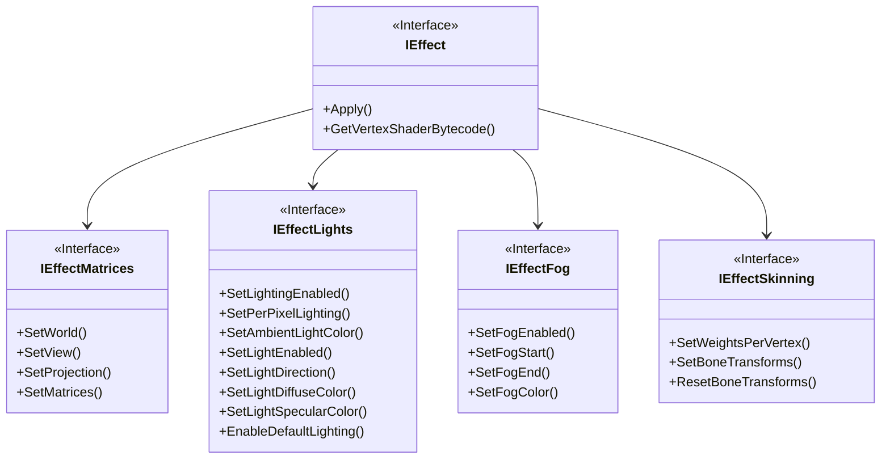

|[DirectXTK](DirectXTK.md)|[Effects](Effects.md)|
|---|---|

This is the abstract interfaced implemented by all effects in _DirectX Tool Kit_, and is typically used as the 'base' reference. For example, [ModelMeshPart](ModelMeshPart.md) defines a reference to an effect as

```cpp
std::shared_ptr<IEffect> effect;
```



```cpp
class DirectX::IEffect;
```

# Usage

## Drawing
The **Apply** method is used to set up a device context for drawing with the effect. This includes setting up the appropriate vertex and pixel shaders (and potentially other shader stages as well), and updating and setting the required constant buffer(s) consumed by these shaders.

The caller is assumed to handle setting the appropriate input layout, vertex and index buffer, primitive topology, blend state, depth-stencil state, and rasterizer state. Texturing effects will also set the shader resources needed for the texturing modes it supports, but assumes the caller has set up the appropriate samplers.

> [GeometricPrimitive](GeometricPrimitive.md) and [Model](Model.md) set the various state settings to reasonable defaults as part of their prepare and/or drawing methods. [PrimitiveBatch](PrimitiveBatch.md) only sets vertex buffer, index buffer, primitive topology leaving the rest of the device state vector up to the caller.

```cpp
m_states = std::make_unique<CommonStates>(device);

...

deviceContext->OMSetBlendState(m_states->Opaque(), nullptr, 0xFFFFFFFF);
deviceContext->OMSetDepthStencilState(m_states->DepthDefault(), 0);
deviceContext->RSSetState( m_states->CullCounterClockwise() );

auto samplerState = m_states->LinearClamp();
deviceContext->PSSetSamplers(0, 1, &samplerState);

...

effect->Apply( devicecontext );

deviceContext->IASetInputLayout(inputLayout);

auto vertexBuffer = mVertexBuffer.Get();
UINT vertexStride = sizeof(VertexType);
UINT vertexOffset = 0;
deviceContext->IASetVertexBuffers(0, 1, &vertexBuffer,
    &vertexStride, &vertexOffset);

deviceContext->IASetIndexBuffer(mIndexBuffer.Get(), DXGI_FORMAT_R16_UINT, 0);

deviceContext->IASetPrimitiveTopology(D3D11_PRIMITIVE_TOPOLOGY_TRIANGLELIST);

deviceContext->DrawIndexed(mIndexCount, 0, 0);
```

## Input Layouts
Direct3D 11 requires that an input layout is used that matches the signature of the vertex shader used for rendering.  Since effect instances are dynamic and use many different shaders depending on various settings, this requires that the caller have access to the correct vertex shader code to create the input layout. The **GetVertexShaderBytecode** method handles this request.

```cpp
// Setup effect and parameters

...

void const* shaderByteCode;
size_t byteCodeLength;

effect->GetVertexShaderBytecode(&shaderByteCode, &byteCodeLength);

device->CreateInputLayout(VertexPositionNormalTexture::InputElements,
                          VertexPositionNormalTexture::InputElementCount,
                          shaderByteCode, byteCodeLength,
                          pInputLayout);
```

Some dynamic state changes in an effect only impact contstant buffer content, which is easily updated.  Other state changes can result in a different shader permutation, in which case the the associated input layouts may no longer bind (you'll get a Direct3D 11 error at runtime if this occurs).

For the built-in effects, the trigger for needing to create a new layout would be:

* Enabling or disabling lighting (which requires a vertex normal)
* Enabling or disabling per vertex color (which requires a vertex color value)
* Enabling or disabling textures (which requires vertex texture coordinates)
* Changing effect class (BasicEffect <-> SkinnedEffect or DGSLEffect)

# Built-in Effect Notes

All built-in effects require the ``SV_Position`` semantic.

|Effect|Layout requirements|
|---|---|
|AlphaTestEffect|This effect requires ``TEXCOORD0`` and ``COLOR`` if per-vertex colors are enabled.|
|BasicEffect|This effect requires ``NORMAL`` if lighting is enabled, ``COLOR`` if per-vertex colors are enabled, and ``TEXCOORD0`` if texturing is enabled.|
|DebugEffect|This effect requires ``NORMAL`` and ``TEXCOORD0``. If per-vertex colors are enabled, it also requires ``COLOR``.|
|DGSLEffect|This effect requires ``NORMAL``, ``TANGENT``, and ``TEXCOORD0``.|
|DualTextureEffect|This effect requires ``TEXCOORD0`` and ``TEXCOORD1``.|
|EnvironmentMapEffect|This effect requires ``NORMAL`` and ``TEXCOORD0``.|
|NormalMapEffect|This effect requires ``NORMAL`` , ``TEXCOORD0``, and ``TANGENT``. If per-vertex colors are enabled, it also requires ``COLOR``.|
|PBREffect|This effect requires ``NORMAL`` and ``TEXCOORD0``.|
|NPREffect|This effect requires ``NORMAL``, ``COLOR`` if per-vertex colors are enabled, and ``TEXCOORD0`` if texturing or matcap are enabled.|
|SkinnedDGSLEffect|This effect requires ``NORMAL``, ``TANGENT``, ``TEXCOORD0``, ``BLENDINDICES``, and ``BLENDWEIGHT``.|
|SkinnedEffect|This effect requires ``NORMAL``, ``TEXCOORD0``, ``BLENDINDICES``, and ``BLENDWEIGHT``.|
|SkinnedNormalMapEffect|This effect requires ``NORMAL`` , ``TEXCOORD0``, ``TANGENT``, ``BLENDINDICES``, and ``BLENDWEIGHT``. If per-vertex colors are enabled, it also requires ``COLOR``.|
|SkinnedPBREffect|This effect requires ``NORMAL``, ``TEXCOORD0``, ``BLENDINDICES``, and ``BLENDWEIGHT``.|

# Implementing the interface

These methods must be defined by classes that implement this interface:

```cpp
void __cdecl Apply(_In_ ID3D11DeviceContext* deviceContext) override;

void __cdecl GetVertexShaderBytecode(
    _Out_ void const** pShaderByteCode,
    _Out_ size_t* pByteCodeLength) override;
```

> The interface supports move semantics, but not copy semantics.

# Exceptions

Error reporting uses the standard C++ exceptions ``std::exception``, ``std::invalid_argument``, ``std::runtime_error``, ``std::logic_error``, or ``std::bad_alloc``.

> Effect implementations may throw additional exceptions defined in ``<stdexcept>`` or ``<system_error>``.

# Remarks

An `IEffect` in _DirectX Tool Kit for DX11_ typically owns a `ID3D11VertexShader` and `ID3D11PixelShader` object, often caching shared versions of these objects for efficiency. They also typically own one or more `ID3D11Buffer` constant buffer objects.

> Built-in effects have all their shader code integrated into the library, so no shader files are needed at runtime, although effects such as `DGSLEffect` require additional compiled shader object files (`.cso`) at runtime.
