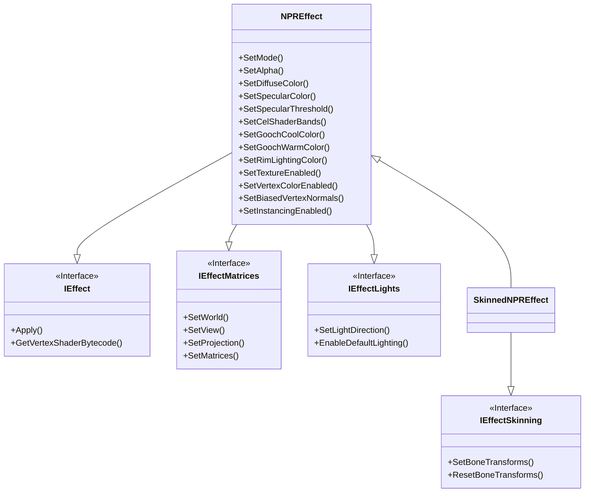

|[DirectXTK](DirectXTK.md)|[Effects](Effects.md)|
|---|---|

**NPREffect** implements *non-photorealistic rendering* techniques such as [cel shading](https://en.wikipedia.org/wiki/Cel_shading), [Gooch shading](https://en.wikipedia.org/wiki/Gooch_shading), and MatCap (material capture) rendering. It provides an optional rim-lighting Fresnel effect for cel and Gooch shading modes.

**SkinnedNPREffect** extends *NPREffect* to support vertex skinning. The skinned effect does not support per-vertex colors or GPU instancing. Texturing is always enabled for the skinned effect as well.

See also [NPREffectFactory](EffectFactory.md)




```cpp
class DirectX::NPREffect :
    public DirectX::IEffect,
    public DirectX::IEffectMatrices,
    public DirectX::IEffectLights
```

```cpp
class DirectX::SkinnedNPREffect :
    public DirectX::NPREffect,
    public DirectX::IEffectSkinning
```

# Header
```cpp
#include <Effects.h>
```

# Initialization
Construction requires a Direct3D 11 device.

```cpp
std::unique_ptr<NPREffect> effect;
effect = std::make_unique<NPREffect>(device);
```

```cpp
std::unique_ptr<SkinnedNPREffect> effect;
effect = std::make_unique<SkinnedNPREffect>(device);
```

For exception safety, it is recommended you make use of the C++ [RAII](https://wikipedia.org/wiki/Resource_Acquisition_Is_Initialization) pattern and use a ``std::unique_ptr`` or ``std::shared_ptr``

# Interfaces
NPREffect supports [IEffect](IEffect.md), [IEffectMatrices](IEffectMatrices.md), and [IEffectLights](IEffectLights.md).

Lighting is always enabled and `MaxDirectionalLights` is 1.

SkinnedNPREffect also supports [IEffectSkinning](IEffectSkinning.md)

Fog settings are not supported.

# Input layout
This effect requires ``SV_Position``, ``NORMAL``, ``COLOR`` if per-vertex colors are enabled, and ``TEXCOORD0`` if texturing or matcap is enabled.

If instancing is enabled, ``NPREffect`` also requires these vertex elements:

```
"InstMatrix", 0, DXGI_FORMAT_R32G32B32A32_FLOAT
"InstMatrix", 1, DXGI_FORMAT_R32G32B32A32_FLOAT
"InstMatrix", 2, DXGI_FORMAT_R32G32B32A32_FLOAT
```

If skinning is used, the vertex layout requires ``BLENDINDICES`` and ``BLENDWEIGHT``.

# Properties

* **SetMode**: Sets which debug shader to use. Defaults to ``Mode_Cel``:

<table>
 <tr>
 <td>Mode_Cel</td><td>Cel shading (a.k.a. toon shading)</td>
 </tr>
 <tr>
 <td>Mode_Gooch</td><td>Gooch shading (warm/cool technical illustration)</td>
 </tr>
 <tr>
 <td>Mode_MatCap</td><td>Material capture rendering (lit-sphere texture)</td>
 </tr>
</table>

* **SetDiffuseColor**: Sets the diffuse color of the effect. Defaults to white (1,1,1). Alpha channel (.w component) is ignored.

* **SetSpecularColor**: Sets the specular color of the effect. Defaults to white (1,1,1).

* **SetSpecularThreshold**: Sets the specular threshold and smoothing value for the effect. Both values must be in the 0 to 1 range. _Note that this is a linear value between 0 and 1 and not a Phong power value_.

* **DisableSpecular**: Disables the specular lighting for the effect.

* **SetAlpha**: Sets the alpha (transparency) of the effect. Defaults to 1 (fully opaque). This value is also used for binning opaque vs. transparent geometry.

* **SetColorAndAlpha**: Sets the diffuse color of the effect and the alpha (transparency).

* **SetVertexColorEnabled**: Enables per-vertex color. Defaults to false. Modifying this setting requires recreating associated input layouts, and enabling it requires ``COLOR``.

* **SetTextureEnabled**: Enables texturing. Defaults to false. Modifying this setting requires recreating associated input layouts, and enabling it requires ``TEXCOORD0``.

* **SetTexture**: Associates a texture shader resource view with the effect. Can be set to nullptr to remove a reference. Can optionally include an alpha channel as well.

* **SetBiasedVertexNormals**: Enables support for compressed vertex normals which require ``*2 - 1`` biasing at runtime such as ``DXGI_FORMAT_R10G10B10A2_UNORM``.

* **SetInstancingEnabled**: Enables support for per-vertex instancing by adding a per-vertex ``XMFLOAT3X4`` transform matrix.

## Cel/toon shading

* **SetCelShaderBands**: Sets the number of cel bands when rendering. Defaults to 4.

## Gooch shading

* **SetGoochCoolColor**: Sets the 'cool' color for Gooch shading and *alpha* weight.

* **SetGoochWarmColor**: Sets the 'warm' color for Gooch shading and *beta* weight.

## MatCap rendering

* **SetMatCap**: Sets the material capture (matcap) texture to use when rendering in this mode. Uses the same texture coordinates as texturing (i.e. ``TEXCOORD0``).

## RimLighting

* **SetRimLightingColor**: Sets the rim-lighting color. Defaults to black (0,0,0).

* **SetRimLightingPower**: Sets the rim-lighting power. Defaults to 4.

* **SetRimLightingIntensity**: Sets a multiplier for the rim-lighting effect in the range of 0 to 1. Defaults to 0.75.

* **SetRimLightingRange**: Sets the rim-lighting range between 0 and 1. Defaults to [0.2, 0.6].

* **DisableRimLighting**: Disables the rim-lighting effect.

> Applies to both Cel/toon and Gooch shading, but not MatCap.

# Exceptions

The ctor can throw ``std::bad_alloc``.

The methods `SetSpecularThreshold`, `SetMode`, `SetCelShaderBands`, `SetRimLightingIntensity`, `SetRimLightingRange` can throw `std::invalid_argument`.

For *SkinnedNPREffect*, calling  ``SetTextureEnabled(false)``,  ``SetVertexColorEnabled(true)``, or ``SetInstancingEnabled(true)`` will throw `std::invalid_argument`.

# Remarks

The cel and Gooch shading always uses 1 directional light, and material capture lighting all comes from the matcap texture.

`SetLightingEnabled`, `SetPerPixelLighting`, `SetAmbientLightColor`, `SetLightEnabled`, `SetLightDiffuseColor`, and `SetLightSpecularColor` are not implemented by this effect.

# Further reading

[Unity Shaders|MatCap casestudy](https://thecuttlefish.github.io/matcap.html)   
[MatCap Library on GitHub](https://github.com/nidorx/matcaps)
